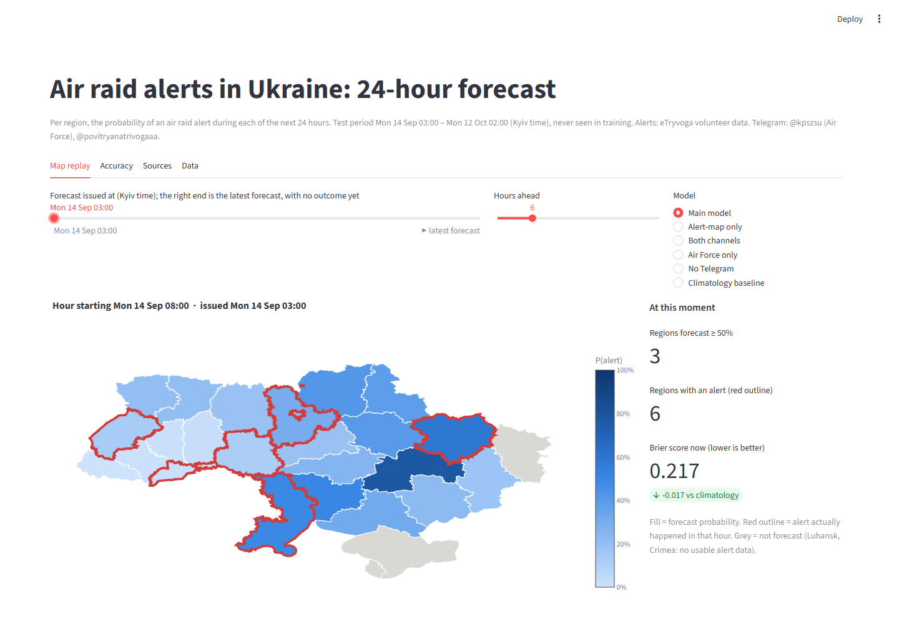
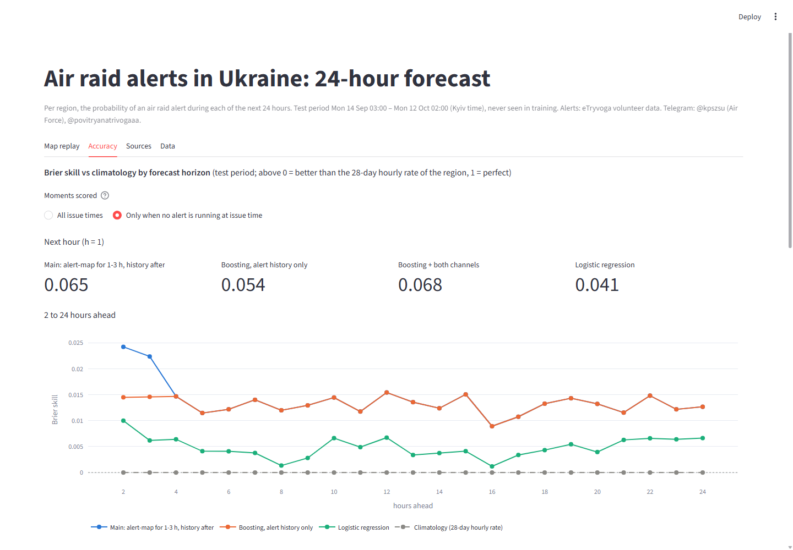
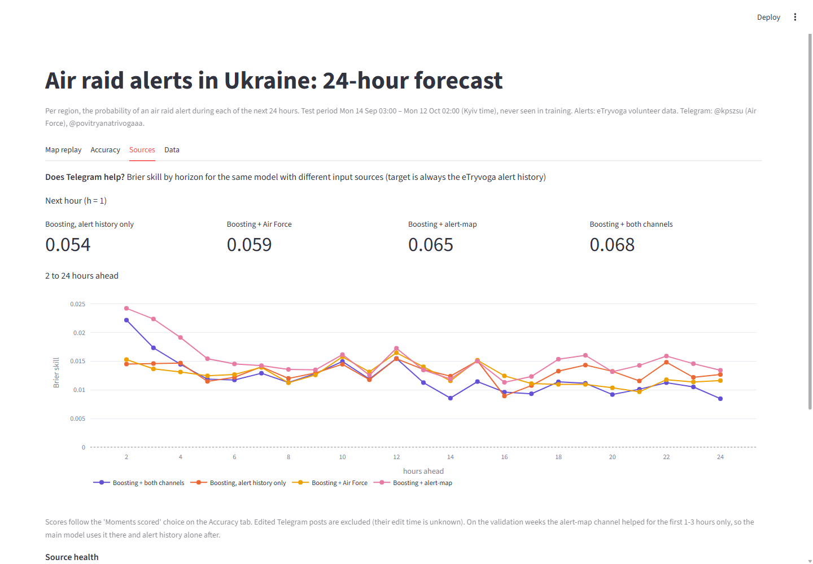
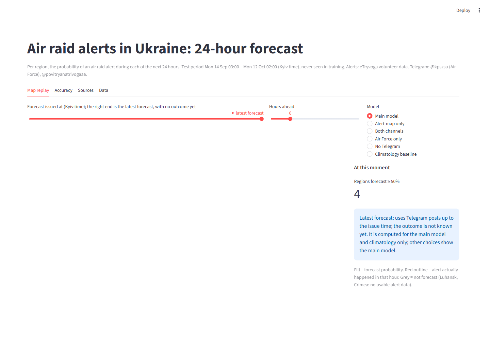
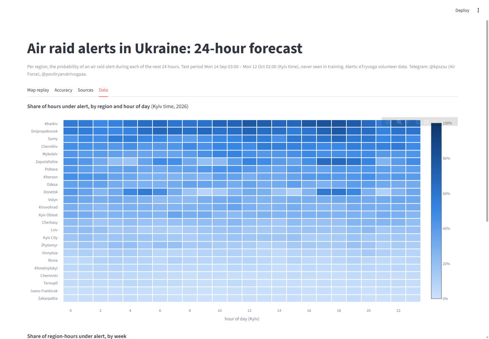

# Air raid alerts in Ukraine: a 24-hour forecast without look-ahead

Every hour, for each of 24 regions (23 oblasts + Kyiv City), the model gives the probability that an
air raid alert will be active during each of the next 24 hours. It learns from the alert history and,
optionally, from two public Telegram channels: the Air Force of Ukraine (@kpszsu) and a volunteer
alert-map channel (@povitryanatrivogaaa). It is evaluated on the last four weeks of data
(14 Sep – 12 Oct 2026), which it never saw during training.



## Results (test period, 14 Sep – 12 Oct 2026, 380k forecasts)

Brier skill = improvement in Brier score over **climatology** (the region's alert share at that hour of
day over the last 28 days, a strong baseline). "Quiet" = no alert running when the forecast is issued,
i.e. "will a new alert start?". Edited Telegram posts are excluded (see leakage, point 4).

| Model | Brier | AUC | Skill (validation) | Skill (test) | Next hour | Next hour, quiet | 3 h ahead, quiet |
|---|---|---|---|---|---|---|---|
| Climatology | 0.184 | 0.754 | 0 | 0 | 0 | 0 | 0 |
| Persistence ("as now") | 0.342 | 0.537 | −0.789 | −0.859 | −0.166 | −0.512 | −0.793 |
| Logistic regression (alert history) | 0.182 | 0.762 | 0.016 | 0.009 | 0.111 | 0.041 | 0.006 |
| Boosting, alert history only | 0.179 | 0.765 | 0.028 | 0.025 | 0.258 | 0.054 | 0.015 |
| Boosting + Air Force channel | 0.179 | 0.765 | 0.023 | 0.024 | 0.260 | 0.059 | 0.014 |
| Boosting + alert-map channel | 0.179 | 0.766 | 0.027 | 0.026 | 0.258 | 0.065 | 0.022 |
| Boosting + both channels | 0.180 | 0.765 | 0.026 | 0.024 | 0.263 | 0.068 | 0.017 |
| **Main: alert-map for 1–3 h, alert history after** | **0.179** | **0.765** | **0.028** | **0.025** | **0.258** | **0.065** | **0.022** |

What this says:

* **The next hour is where the skill is.** Mostly from "an alert is running now", but even at quiet
  moments the model is ~6 % better than climatology one hour ahead.
* **Beyond ~3 hours the daily rhythm dominates.** All models are only 1–2 % better than climatology:
  in the test period a region had 6.5 alerts a day with a median length of 18 minutes, so *which* hour
  is hard to call far ahead.
* **Telegram helps for the first 1–3 hours, not after.** At quiet moments a post naming the region in
  the last hour doubles the chance of an alert in the next hour (20 % → 41 %); next-hour skill at quiet
  moments goes from 0.054 (no Telegram) to 0.065, and 3 hours ahead from 0.015 to 0.022. Further ahead,
  Telegram features add noise, so the main model drops them after 3 h.
* **The main model was chosen on the validation weeks only**: at quiet moments the alert-map channel
  was best for 1–3 h and alert history alone for 4–17 h (it also won some of 18–22 h by small margins;
  a single switch point at 3 h was kept as the simpler, more defensible rule). On the test weeks the
  alert-map-only model scores slightly higher overall (0.026 vs 0.025), but switching to it after seeing
  the test would be leakage.
* **The official Air Force channel adds little.** A possible reason (not verified): 16 days with
  unusually few posts, which the model may read as a quiet sky.
* **Edited posts matter.** Keeping them, the alert-map model looked best everywhere on validation
  (0.032); without them it drops to 0.027. The channel updates big route summaries in place, mostly
  without "UPD", and Telegram does not show when, so those edits can carry later information. All
  numbers above exclude edited posts; `--include-edited` reproduces the comparison
  (`results/*_with_edited.*`).

| | |
|---|---|
|  |  |
|  |  |

## What went wrong along the way (and what changed)

* **Official data stopped.** The official alert file and the official alert channel both stop on
  7 Sep 2026, so the plan to fill the gap by scraping that channel was dropped; the volunteer file
  became the target.
* **Horizon off by one.** "1 hour ahead" first meant the hour *after* the next one, which hid exactly
  the hour where alert state and Telegram matter. Found because persistence looked implausibly weak;
  fixed and pinned in the leakage test.
* **Scores flattered by running alerts.** With an alert running, "next hour = yes" is trivial, so
  results are also reported for quiet moments only.
* **Leakage test caught a real bug** on its first run (countrywide counts depended on which duplicate
  row of a post was kept).
* **Picking the best source set on the test chart would have been leakage** (the alert-map model
  looked best there); the choice was made on validation instead.
* **A robustness check turned into a leakage fix.** Dropping edited Telegram posts was meant as a
  sanity check, but it removed most of the alert-map channel's advantage on validation: route summaries
  are edited in place with later positions. Edited posts are now excluded by default, and the model
  choice was redone on validation (alert-map only for 1–3 h).
* **Map drawn inside-out.** GeoJSON polygons wind counter-clockwise, Plotly expects clockwise, so
  every region covered the globe; found with a Playwright screenshot.

## Quick start

Python 3.10+ on Windows, macOS or Linux; the same commands everywhere.

```bash
python -m venv .venv
# Windows: .venv\Scripts\activate      macOS/Linux: source .venv/bin/activate
pip install -r requirements.txt
python -m airraid gui            # GUI in your browser (http://localhost:8501), from the committed results
pytest                           # includes the leakage tests

# Re-create everything from scratch (about 15 minutes):
python -m airraid fetch          # alert CSV (pinned version) + Telegram pages since 1 Jan 2026
python -m airraid backtest       # weekly-retrained evaluation -> results/
python -m airraid forecast       # forecast for the 24 h after the end of the data
python -m airraid backtest --include-edited   # comparison: with edited Telegram posts
```

`results/` is committed, so the GUI works right after `pip install`. The GUI only listens on localhost.

## Data

| Source | What | Period used | Role |
|---|---|---|---|
| [Vadimkin/ukrainian-air-raid-sirens-dataset](https://github.com/Vadimkin/ukrainian-air-raid-sirens-dataset), volunteer file (eTryvoga) | oblast-level alert intervals | to 12 Oct 2026 00:00 UTC, pinned to commit `d10c80f` | **target** and alert-history features |
| [@kpszsu](https://t.me/s/kpszsu) (Air Force) | 34,220 posts: drone, missile, guided-bomb tracks by region | 1 Jan – 12 Oct 2026 | signal features |
| [@povitryanatrivogaaa](https://t.me/s/povitryanatrivogaaa) (volunteer alert map) | 53,806 posts: drone routes, explosions, missile tracks | 1 Jan – 12 Oct 2026 | signal features |
| Same dataset, official file | raion-level alerts | stops 7 Sep 2026 | cross-check only |

Why the volunteer file is the target: the official file stops on 7 Sep 2026 (its Telegram source stopped
posting that day), and since December 2025 official alerts are declared per raion, so "any raion of the
oblast under alert" is true almost all the time near the front (Donetsk 99.8 % of hours). The two
sources agree on 81 % of oblast-hours in Jun–Sep 2026
(`scripts/compare_alert_sources.py`, `results/alert_source_agreement.csv`); neither can be called
ground truth, so this is listed as a limitation.

Luhansk (permanent alert since 2022, 3 records), Crimea and Sevastopol (not in the data) are not forecast.

## How it works

```
sources/ (one adapter per source)        core (never sees a source name)
  etryvoga.py        -> AlertInterval  ─┐
  telegram.py kpszsu -> SignalEvent    ─┼─> hourly.py -> features.py -> models.py -> backtest.py -> results/ -> app.py
  telegram.py alertmap -> SignalEvent  ─┘
```

* **Internal format** (`airraid/schema.py`): alerts are `region, start_utc, end_utc`; signals are
  `published_at_utc, region | None, kind, ref, edited`. Every source also reports the period it covers,
  so a gap in a source becomes "unknown" (NaN), never "quiet" (0). Adding a source = one adapter + one
  line in `airraid/sources/__init__.py`; switching sources on/off is the `signals` setting in
  `airraid/config.py`.
* **Telegram parsing** is deterministic: ordered emoji/keyword rules per channel, Latin look-alike letters
  fixed ("Kиїв"), short follow-ups ("На Боярку") inherit the previous threat type, summaries/maps/news
  dropped, region names matched with inflections ("Харкова", "Вінничині") plus towns found by listing the
  most frequent unmatched words. 92 % / 93 % of threat posts are mapped to a region; most of the rest are
  genuinely countrywide (ballistic threat, MiG-31K take-off). Real posts are pinned in
  `tests/test_telegram_rules.py`.
* **Features at issue time t** (`airraid/features.py`): the region's alert state (alert running now and
  for how long, hours since the last one), its alert share over the last 3 h/24 h/7 d/28 d, neighbours
  and the whole country now, the region's alert share at the same hour of day over the last 28 days,
  hour of day and weekday of the target hour, horizon, and per Telegram source: posts naming the region
  in the last 1/3/6 h and countrywide posts in the last 3/24 h by threat group (drone, missile, aviation,
  explosion, all-clear).
* **Models**: climatology (28-day rate for this region and hour of day), persistence, logistic regression
  on alert history, and gradient boosting (`HistGradientBoostingClassifier`) once per source set. The
  main model uses the alert-map boosting model for 1–3 h ahead and the alert-history one after
  (`SHORT_HORIZON` in `airraid/backtest.py`, chosen on validation).
* **Reproducibility**: the alert CSV is pinned to a dataset commit; Telegram posts get edited and
  deleted, so the parsed events (no post text) are committed in `data/snapshot/` and used when no raw
  download exists.
* **Evaluation**: validation = 4 weeks before the test (used for choices), test = last 4 weeks (run
  once). The model is retrained every week on the previous 182 days and predicts the following week.
  Scores: Brier score, log loss, ROC AUC, calibration; Brier skill is relative to climatology.

## No data leakage: how it is enforced

1. **Time split, weekly walk-forward.** A training row is only used if all 24 of its target hours ended
   before the week being predicted (asserted in `backtest.py`).
2. **One place reads the inputs.** `features.build` uses hours before t, alerts that started before t
   (a running alert's end is not used) and posts published before t.
3. **Tested, not promised.** `tests/test_leakage.py` rebuilds every feature from data cut off at t, the
   way it was known at t, and requires identical values; a planted feature that peeks at the label is
   caught. On its first run the test caught countrywide counts that depended on which duplicate row of
   a post was kept.
4. **Telegram edits.** Telegram shows the original publish time but the latest text, and not when it
   was edited. Edited posts (2 % / 14 % of posts, mostly map images in the second channel) are
   **excluded**: the alert-map channel updates route summaries in place, so an edited post can carry
   information from after its timestamp. (Text after "UPD" is also cut, e.g. a post published 10:20
   ending with "UPD 13:21: не фіксується".)
5. **The data snapshot.** The dump omits alerts still running when it was made (05:05 UTC), so data is
   treated as complete only until 00:00 UTC; hours after that have no label.
6. **No hand-written knowledge of the test period** (no event dates, no feature chosen because of what
   happened in it). Town names were added from words in the posts; region neighbours were checked
   against real boundaries.

## Limitations

* The target is one volunteer source; the official one disagrees on ~19 % of oblast-hours.
* Alerts with no all-clear message get a 30-minute end in the source (`naive`); that end is hindsight a
  real-time observer would not have had. Alerts longer than 12 h are cut at 12 h (missed all-clear).
* Deleted Telegram posts are invisible. Excluding edited posts removes some genuine signal along with
  the possible leaks.
* The latest forecast is issued at the end of the alert snapshot (12 Oct 00:00 UTC), not "now".

## Repository

```
airraid/            package: regions, schema, sources/, hourly, features, models, backtest, evaluate, cli
app.py              Streamlit GUI
scripts/            one-off analyses (official vs volunteer alert data)
tests/              leakage, Telegram rules, regions
results/            predictions, metrics, forecast, data context (read by the GUI)
data/snapshot/      parsed Telegram events (time, region, threat type; no text)
```

Boundaries: [geoBoundaries](https://www.geoboundaries.org) UKR ADM1, © OpenStreetMap contributors, ODbL.
